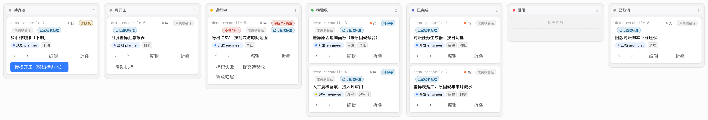
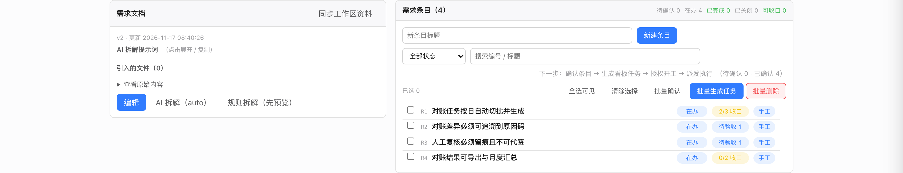
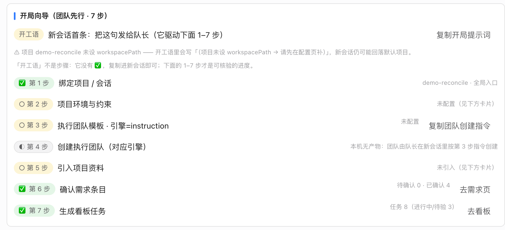
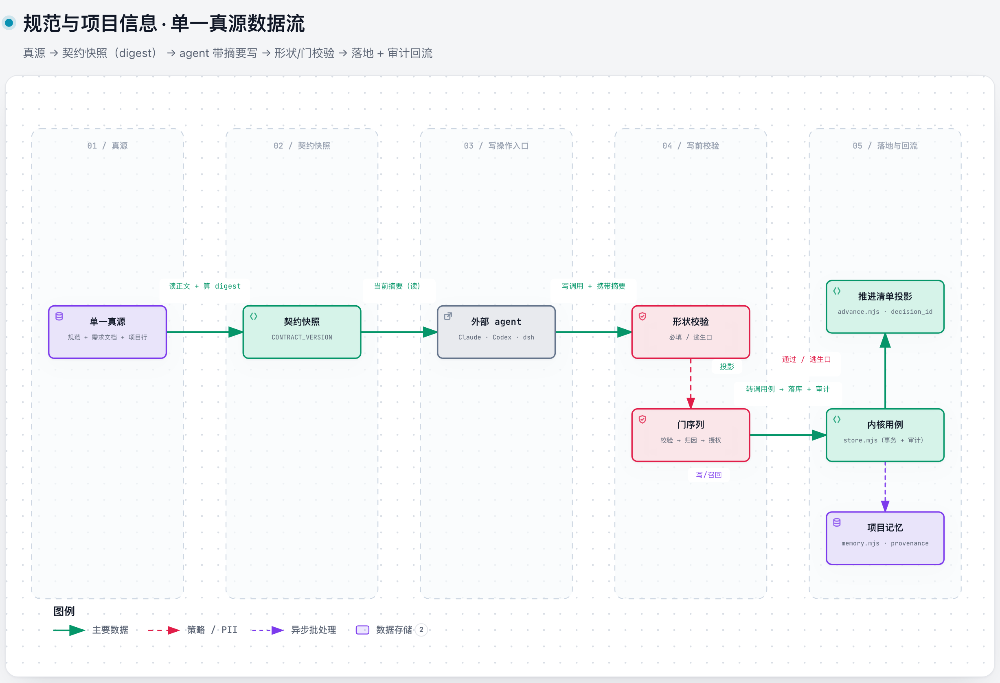

# taskboard-workbench

> **Agent Team 任务工作台**：一个本地优先（local-first）的多项目任务看板，
> 零运行时依赖（`node:sqlite`），既可独立跑成 **CLI + 本地 Web 服务**，也能作为
> **DSH（DeepSeek Harness）内嵌插件**挂进会话里，派发任务、回流证据、独立复验。

---

## 界面



*看板：`待办池 → 可开工 → 进行中 → 待验收 → 已完成 / 受阻 / 已取消` 七列同屏。
卡片上可见「未归属」「已记录验收标准」「诊断」徽标，以及按角色分派的执行入口。*



*需求视图：左侧是需求文档与 AI 拆解入口，右侧是条目行式列表 ——
每条带**完成度胶囊**（如 `2/3 收口`）、**来源标签**（手工 / 资料索引 / AI / 规则 / MCP）与批量建卡入口。*



*配置页的「开局向导 7 步」是**真实判定**，不是装饰：第 4 步显示「本机无产物」待人确认（◐），
已确认的步骤才是 ✅。*

> 三张图均为**独立进程形态**（`node src/server/server.mjs`，无 DSH 宿主）下的虚构示例项目，
> 不含真实业务数据；独立进程下顶部会出现「无宿主会话通道」提示条，截图已省略。

## 机制图：单一真源数据流



*规范与项目信息只有一份真源：正文在磁盘（`spec/norms/` + 需求文档），项目行在库（`taskboard.sqlite`）。
读取方先算 `digest` 得到契约快照；外部 agent 写之前必须带上摘要；落库前依次过形状校验、归因与授权门；
落地后审计、推进清单与项目记忆都从同一份记录回流。图内节点与数据为**虚构示例**，只示机制。*

五段泳道对应这条链路上的五个位置：

| 段 | 位置 | 作用 |
| --- | --- | --- |
| 01 真源 | `spec/norms/` + 需求文档 + 项目行 | 正文与项目事实的唯一来源，不留第二份副本 |
| 02 契约快照 | `CONTRACT_VERSION` / `contract_version` | 读正文算 `digest`，**只算不改**；快照用来判「读到的是不是当前版本」 |
| 03 写操作入口 | 外部 agent（Claude · Codex · dsh） | 写调用必须带摘要：不带拒 `NORM_DIGEST_REQUIRED`，过期拒 `NORM_STALE` 并回带最新正文 |
| 04 写前校验 | 形状校验 → 门序列 | 先判形状（必填 / 逃生口），再走「校验 → 归因 → 授权」；口径只写在一处，不新造 |
| 05 落地与回流 | `store.mjs` / `advance.mjs` / `memory.mjs` | 事务 + 审计落地；推进清单是**纯投影**；项目记忆默认 `proposed`，需人确认才生效 |

> 这张图讲的是**机制**（对应下文的 MCP 契约层），不是界面截图；真机形态见上面三张。

## 它解决什么

把「需求条目 → 看板派发 → CLI/agent 实际开发 → 证据回流 → 独立复验 → 人工验收」
这条闭环固化成可查询的数据与可重放的流程，而不是散落在聊天记录里。

- **任务不是聊天**：任务卡有状态机（`backlog → todo → in_progress → in_review → done`）、
  乐观锁（`--if-version`）、认领锁与心跳、失败会计与熔断。
- **证据留在卡上**：评论、事件流、尝试记录、诊断信息都挂在任务上，可回溯。
- **人工守住最后一道门**：执行侧只能把卡推到「待验收」，`done` 必须由人确认。

## 功能概览

| 模块 | 内容 |
| --- | --- |
| 存储核心 | 零依赖 SQLite（`node:sqlite`）；多项目 / 任务 / 需求条目；状态机、父任务、标签、负责人、版本号乐观锁 |
| 看板 | 七列状态看板（拖拽换列 + 列内排序）、多维筛选与搜索、卡片抽屉（下一步 / 概览 / 执行记录 / 关联） |
| 需求视图 | 条目行式列表 + 详情抽屉、引入文件按文件夹树呈现、来源标签（手工 / 索引 / AI / 规则 / MCP）、批量建卡 |
| 执行编排 | **按卡选执行者**（团队 / 宿主会话 / claude·codex·hermes）；CLI 执行者交**项目主会话**下发并跟踪；派发优先复用已绑定空闲会话；执行期心跳与在途尝试收口 |
| 交付与证据 | 四节证据 + 可核验引用（`commit` / `file`）双通道、WAL、ticket 阶段视图、抽屉「执行记录」聚合段 |
| 团队协作 | 团队任务 ↔ 看板卡**只读映射**、执行引擎（`instruction` / `agent-teams` / `official`）、诊断（评审死锁 / 停滞 / 假阳性收敛） |
| 双宿主 | web 与 desktop **共用同一份库**：写者租约 + 只读跟随条 + `dataDir` 自证 |
| CLI | `tb` 命令（项目 / 任务 / 评论的 CRUD，JSON 输出 + 稳定退出码） |
| MCP | **10 个工具**（只读 5 + 写 5）+ prompt `taskboard.flow`，stdio 传输 |
| DSH 插件 | `dsh.bundle.patch` + `dsh.client`（web 平台侧栏 / 布局 / 槽位注入），会话内「任务工作台」标签页 |

## 安装

### 作为 DSH 插件

```bash
dsh plugin --profile web add taskboard-workbench
```

插件通过 `dsh.bundle.patch`（`cordis.patch.yml`）与 `dsh.client` 注入到宿主；
需要宿主支持的 `@deepseek-ai/dsh-client-ui-{layout,sidebar,slots}`（已声明为**可选 peer**）。

装好后在 DSH 里打开「任务工作台」面板（地址以 `/integrations/taskboard-workbench` 结尾）。
**只有这个形态拿得到宿主会话通道**：`GET /api/health` 的 `host.capabilities` 非空，
「投给主会话 / 打开会话 / 派发团队」才可用。

> 验收这条链路（从 `npm pack` 产物装进全新隔离 profile，真宿主起会话）：
> `node tools/bench-market-install.mjs` —— 11 项，含「独立进程无宿主通道」的反向对照。

### 从源码

```bash
git clone https://github.com/SilenZerOrz/taskboard-workbench.git
cd taskboard-workbench
dsh plugin --profile web add .
```

### 独立跑（不用 DSH）

```bash
npm start                      # 启动本地 Web 服务（默认监听本机端口）
node cli/tb.mjs project list   # 或用 CLI 直接操作
```

> ⚠️ 独立进程**没有** DSH 宿主会话通道：`/api/health` 的 `host.capabilities` 恒为 `null`，
> 「投给主会话 / 打开会话 / 派发团队」不可用（界面按能力位置灰并常驻提示）。
> 看板、建卡、改状态、评审、人工收口照常可用。要投递或派发，请用上面的**插件形态**。

## 要求

| 项 | 值 |
| --- | --- |
| Node.js | `>= 22.5.0`（依赖 `node:sqlite`） |
| DSH | `>=0.2.1-rc.3`（与 `package.json#engines.dsh` 一致）；`0.2.2-rc.3` 真机验证通过 |
| 运行时依赖 | 无（`dependencies` 为空） |

## 快速上手（CLI）

```bash
# 数据目录：--data-dir > $TB_DATA_DIR > 系统临时目录
export TB_DATA_DIR="$HOME/.taskboard-data"

node cli/tb.mjs project create --name "示例项目" --id demo
node cli/tb.mjs task create --project demo --title "跑通一次闭环" --description "验证一下"
node cli/tb.mjs task list --project demo
node cli/tb.mjs comment add 1 --body "证据：npm test 全绿"
```

CLI 约定：成功 `stdout` 输出 JSON（含 `schemaVersion`），退出码 `0`；
失败 `stderr` 输出 `{schemaVersion, error:{code,message}}`，退出码 `2/3/4/5`。
并发编辑用 `--if-version`，版本不符返回 `VERSION_CONFLICT`（退出码 5）而不静默覆盖。

## MCP 契约层（十个工具）

把「开局要读什么、规范长什么样、哪里有漂移、卡怎么建、进度怎么回填」做成 agent 可直接调用的接口，
让 Claude Code / Codex / Hermes 等外部 agent 不必靠人肉复制粘贴就能对齐同一份项目事实。

```bash
node src/mcp/server.mjs --data-dir "$TB_DATA_DIR"   # MCP 客户端作为子进程拉起（stdio）
node src/mcp/server.mjs --print-tools               # 只打印工具清单（调试用）
node src/mcp/server.mjs --read-only                 # **只读模式**：只暴露五件只读工具，写四件调用即 READ_ONLY_MODE
npm run mcp -- --data-dir "$TB_DATA_DIR"            # 同上，走 npm script
```

`--read-only` 是写工具的**回滚开关**（写路径出问题时的逃生口）：`tools/list` 里不再出现
`card_create` / `card_evidence_submit` / `card_progress` / `requirement_upsert` / `requirement_change`，直接调用返回
`isError:true` + `code=READ_ONLY_MODE`（**不是**「未知工具」，便于区分「开关生效」与「名字拼错」）。
不带该参数时行为不变（10 个工具）。

传输是 **stdio + newline-delimited JSON-RPC 2.0**（MCP stdio transport）：
**不占端口、不碰 `:3080`、不写 `~/.dsh/**`、不需要重载宿主**，每个 agent 会话一个进程。

### 只读五件

| 工具 | 用途 |
| --- | --- |
| `flow_start` | 开局第一步（S0）：项目身份 + `contract_version` + 缺口（未归因卡 / 未绑定主会话 / 待确认候选）+ 下一步建议 |
| `project_info` | 项目总览：任务与需求条目按状态计数 + 契约版本与基线是否漂移 |
| `norm_get` | 取机器规范正文（`flow` / `card-update` / `doc-editing` / `acceptance` / `project-defaults`；`norm="project"` 读项目自有 `<workspace>/AGENTS.md`）+ `digest` |
| `requirement_list` | 需求条目列表：条目 + 内容版本（乐观锁用）+ 每条下的卡数与完成数 |
| `workbench_audit` | 漂移盘点：`contract-stale` / `unattributed` / `unbound-session` / `candidate-flood` 四类，各带计数、样例与处置建议 |

### 写五件（形状即约束）

| 工具 | 强制的形状 | 被拒的样子 |
| --- | --- | --- |
| `card_create` | **归因硬门**：`requirement` 或显式 `unattributed_reason`（落审计）。新卡只能进 `backlog` | `REQUIREMENT_REQUIRED` / `AUTHORIZATION_REQUIRED`（`backlog → todo` 是人工授权） |
| `card_evidence_submit` | 四节证据（判定 / 偏离 / 边界）+ 产物 + **可核验引用**（`kind` 只接受 `commit` / `file`） | `EVIDENCE_INCOMPLETE` / `INVALID_ARTIFACT_REF`（第几项非法） / 同一批证据按 `hash` 去重 |
| `card_progress` | `evidence[]` **非空**（每项 `{kind: file\|command\|url\|reading, ref, note?}`）+ **`norm_digest` 必填**（`card-update` 的 sha256） | `EVIDENCE_REQUIRED` / `NORM_DIGEST_REQUIRED` / `NORM_STALE`（回带最新正文）/ `GOVERNANCE_AGENT_DONE` |
| `requirement_upsert` | 改条目必须带 `expected_version`（`requirement_list` 返回的 `version`） | `MISSING_VERSION` / `VERSION_CONFLICT` |
| `requirement_change` | 先预览拿 `change_id` + 影响面 `affected_cards`，带 `change_id` + `apply:true` 才落地 | `CHANGE_NEEDS_APPROVAL` / `CHANGE_ID_MISMATCH`（预览后条目被改过即失效） |

**四条红线仍然由门守，不是由纪律守**：

1. `done` 只能人点 —— `card_progress` 走执行侧状态门，写 `done` 直接 `GOVERNANCE_AGENT_DONE`；
2. `backlog → todo` 是人工授权 —— `card_create` 只接受 `backlog`；
3. 人工校验任务不得被执行侧改状态；
4. 证据不能是「已完成」三个字 —— `evidence[]` 的形状就是判据；同一批证据重复回填会按 `hash` 去重。

**契约档位**：`contract_version` 目前仍是 **`warn`** 档（不符只落 `contract-warn` 审计、不阻断），
切 `reject` 要等观察期到点单独拍板；写工具的返回体里带 `contract.verdict` 让 agent 自己知道用没用旧规范。

数据源是**同一个** `taskboard.sqlite`（`--data-dir` > `$TB_DATA_DIR` > 默认），
MCP 不是第二份数据 —— 看板里看到的、CLI 改的、MCP 读的，是同一行记录。
`tests/mcp-parity.test.mjs` 守的就是这条：同一操作在 HTTP 与 MCP 上**错误码与副作用必须同形**。

同一个 server 还提供一个 **MCP prompt `taskboard.flow`**（`prompts/list` / `prompts/get`）：
内容是当前项目的「开局装载块」—— 契约版本、门档、六类缺口、下一步该做什么、八步表与五条硬规则。
它与 CLI 的 `tb-flow start` **共用一个生成器**，输出逐字节相同（`tests/skill-flow.test.mjs` 守这条）。

## 技能包（开局装载）

`skills/taskboard-flow/` 是给 agent 读的**主流程技能**（八步 S0–S7 × 六栏：入口 / 前置门 / 判据 /
证据落点 / 失败处置 / 对应 FR），随包分发。它**只教顺序与判据，不持有业务规则副本** ——
数据在 `taskboard.sqlite`，门在 `src/mcp/` 与 `src/core/`，机器规范在 `spec/norms/`。

```bash
npm run flow -- start --data-dir "$TB_DATA_DIR" --project demo   # 打印开局装载块（档 A：整块贴进会话）
npm run flow -- start --json                                     # 同上，结构化输出
npm run flow -- snippet                                          # 打印档 B 的 AGENTS.md 片段
npm run flow -- check                                            # 自检 frontmatter 与八步完整性
node scripts/tb-flow.mjs start --cwd /path/to/repo                # 缺项目时按 cwd / 目录名猜
```

三种开局方式，按侵入性排序：

| 档 | 谁用 | 怎么做 | 要不要改宿主 |
| --- | --- | --- | --- |
| **A 开局提示词** | 人在 dsh 主会话里新开一轮 | 贴 `tb-flow start` 输出；或 MCP 客户端取 prompt `taskboard.flow` | 不用 |
| **B 外部 agent 约定** | Claude Code / Codex 在项目仓库里开工 | 项目根 `AGENTS.md` 写「开工先跑 `<taskboard>/scripts/tb-flow.mjs start`」，片段用 `tb-flow snippet` 打印 | 不用 |
| **C 宿主自动注入** | dsh 会话创建即注入 | **未启用**（须报批改 `~/.dsh/**` 并重载宿主）；接口形状见 `skills/taskboard-flow/references/injection.md` | 须报批 |

## 配置

| 环境变量 | 作用 | 默认 |
| --- | --- | --- |
| `TB_DATA_DIR` | SQLite 数据目录 | 系统临时目录（仅适合试跑，正式用请显式指定） |
| `TB_PORT` | 独立进程监听端口 | `47830` |
| `TB_HOST_URL` | `tb-flow --host` 的默认基址 | `http://127.0.0.1:3080` |
| `TB_BASE` | 开局「设置类判据」里 `node -e` 取项目设置的基址 | 同上 |
| `TEAM_ENGINE` | 团队执行引擎：`instruction`（默认，指令降级）/ `agent-teams` / `official` | `instruction` |

项目级配置（工作区路径、审批策略、执行者选择、会话关联、规范来源等）在 Web 看板的「配置」页里维护。


## 目录结构

```
index.js              DSH 插件入口（cordis patch 注入点）
lib/client.js         宿主侧客户端桥
cordis.patch.yml      dsh.bundle.patch
src/core/             存储、状态机、团队模板、执行编排、看护
src/server/           HTTP API 与事件流
src/host/             团队引擎与工具面
src/mcp/              MCP 契约层（stdio server + 十个工具：只读五 / 写五 + prompt taskboard.flow）
skills/taskboard-flow/ 主流程技能包（八步 × 六栏 + 每步 references + 错误码 + 装载说明）
scripts/tb-flow.mjs   `tb-flow` 开局装载块 CLI（start / snippet / check）
web/                  本地 Web 看板（app.js / tokens.css / index.html）
cli/tb.mjs            `tb` 命令行
spec/团队agent.md      团队契约（随包发布，供工作台里的 agent 读取）
spec/norms/           机器执行规范（运行时唯一真源，随包；manifest.json 带 sha256 digest）
tests/                `node --test` 单测
tools/                开发与验证脚本（不进 npm 包，除 seed/env-check）
assets/readme/        README 截图与机制图（随包发布，用于 GitHub、npm 页面与插件市场）
```

## 测试

```bash
npm test          # node --test，全量单测
node --check index.js   # 语法自检（对每个源文件）
node src/mcp/server.mjs --print-tools   # MCP 工具清单自检
```

## 版本信息

| 项 | 值 |
| --- | --- |
| 当前版本 | **`0.3.5`**（2026-11-17） |
| 发布轨 | `stable` → npm `dist-tags.latest` |
| 版本策略 | `0.3.x` 期 patch 承载「修复 + 可选能力」；`0.4.0` 留给计划文档里预留的确认层 `acceptance_state` |
| dsh 兼容 | `>=0.2.1-rc.3`（`package.json#engines.dsh`）；真机验证 `0.2.2-rc.3` |
| Node 要求 | `>= 22.5.0`（依赖 `node:sqlite`） |
| 运行时依赖 | 无 |
| 变更记录 | [CHANGELOG.md](./CHANGELOG.md) |
| 发布页 | [Releases](https://github.com/SilenZerOrz/taskboard-workbench/releases) |

```bash
npm view taskboard-workbench version            # registry 上的当前版本
npm view taskboard-workbench dist-tags          # 各发布轨指向
npm view taskboard-workbench time --json        # 每个版本的落地时间
```

> **判断要不要升级只看三处**：npm `dist-tags`、本仓库 GitHub Releases、dsh 插件市场条目 ——
> 不要只看 `npm outdated -g`（`latest` 可能滞后于某个预发布轨）。


## 说明：`docs/` 不随仓库发布

本仓库的过程文档（需求 / 计划 / 进度 / 验证 / 规范 / 发布 SOP 等）在本地维护，
**不进入 git 与 npm 包**（见 `.gitignore`）。仓库只发布可运行的代码与随包契约 `spec/`。

## License

[MIT](./LICENSE)
